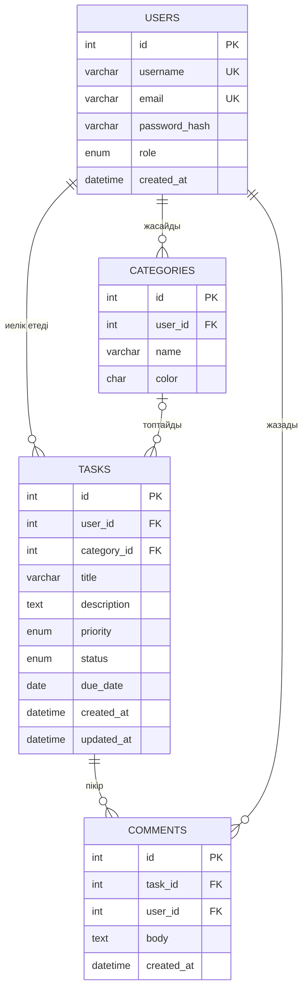

# To-Do Manager — Тапсырмалар менеджері

PHP және MySQL негізінде жасалған веб-қосымша: пайдаланушы өз тапсырмаларын тіркеліп, санаттарға бөліп, мерзімі мен басымдығын белгілеп басқара алады.

> **Курс:** PHP Backend бағдарламалау — жеке жобалық тапсырма
> **Автор:** Қырықбай Зейнеп
> **Мәртебесі:** 8-апта — жоспарлау кезеңі (код әлі жазылған жоқ)

## 1. Жобаның мақсаты

Күнделікті міндеттерді бір жерде жинап, олардың орындалу барысын қадағалайтын қарапайым әрі қауіпсіз онлайн-қосымша жасау. Жоба барысында студент PHP-ның негізгі мүмкіндіктерін қолданады: формалармен жұмыс, сессиялар, MySQL (PDO), CRUD, іздеу/сүзу, валидация және веб-қауіпсіздік.

**Мәселе:** тапсырмалар түрлі жерде (қағазда, чатта, жадыда) шашырап жүреді де, мерзімі ұмытылады.
**Шешім:** әр пайдаланушыға жеке тапсырмалар тізімін ұсынатын, мерзім мен басымдық бойынша реттейтін қосымша.

**Мақсатты аудитория:** студенттер, жұмыс істейтін мамандар, жеке жоспарлауды қалайтын кез келген адам.

## 2. Негізгі мүмкіндіктер

- Тіркелу, кіру және шығу (парольдер хэштеледі)
- Тапсырмаларды қосу, көру, өңдеу, жою (CRUD)
- Тапсырмаға санат, басымдық (low / medium / high) және мерзім беру
- Мәртебе: `todo` → `in_progress` → `done`
- Іздеу, сүзу (санат, мәртебе, мерзім), сұрыптау және пагинация
- Тапсырмаға пікір қалдыру
- Рөлдер: `user` және `admin` (админ-панель)
- Қауіпсіздік: prepared statements, `htmlspecialchars()`, CSRF-токен

Толық тізім: [`docs/pages.md`](docs/pages.md)

## 3. Технологиялар

| Деңгей | Құрал |
|--------|-------|
| Backend | PHP 8.x, PDO |
| Дерекқор | MySQL / MariaDB (utf8mb4) |
| Frontend | HTML5, CSS3, JavaScript |
| Орта | XAMPP (Apache + MySQL), `localhost` |
| Нұсқаларды басқару | Git, GitHub |
| Хостинг (15-апта) | InfinityFree немесе басқа тегін хостинг |

## 4. Беттер тізімі

| Бет | Файл | Кімге қолжетімді |
|-----|------|------------------|
| Басты бет | `index.php` | Барлығы |
| Тіркелу | `register.php` | Қонақ |
| Кіру | `login.php` | Қонақ |
| Шығу | `logout.php` | Пайдаланушы |
| Тапсырмалар тізімі | `tasks.php` | Пайдаланушы |
| Тапсырма қосу | `task_create.php` | Пайдаланушы |
| Тапсырманы өңдеу | `task_edit.php` | Иесі |
| Тапсырманы көру + пікірлер | `task_view.php` | Иесі |
| Тапсырманы жою | `task_delete.php` | Иесі |
| Санаттар | `categories.php` | Пайдаланушы |
| Профиль | `profile.php` | Пайдаланушы |
| Админ-панель | `admin/users.php` | Админ |

## 5. Дерекқор құрылымы (ER-диаграмма)




SQL-схема: [`database/schema.sql`](database/schema.sql)

**Байланыстар:**
- Бір пайдаланушыда көп санат және көп тапсырма болады (1 : N).
- Санат көп тапсырманы біріктіреді; санатсыз тапсырма да болады (`category_id` — NULL).
- Бір тапсырмада көп пікір болады, әр пікірдің бір авторы бар.

## 6. Жоба құрылымы (жоспар)

```
todo-manager/
├── index.php
├── register.php
├── login.php
├── logout.php
├── tasks.php
├── task_create.php
├── task_edit.php
├── task_view.php
├── task_delete.php
├── categories.php
├── profile.php
├── admin/
│   └── users.php
├── includes/
│   ├── db.php
│   ├── auth.php
│   ├── functions.php
│   ├── header.php
│   └── footer.php
├── assets/
│   ├── css/style.css
│   └── js/app.js
├── database/
│   └── schema.sql
├── docs/
│   ├── pages.md
│   ├── er.dot
│   └── er_diagram.png
└── README.md
```

## 7. Орнату (код дайын болғанда)

1. XAMPP-ты іске қосып, Apache және MySQL модульдерін қосыңыз.
2. Репозиторийді `htdocs` қалтасына клондаңыз:
   ```bash
   git clone https://github.com/<username>/todo-manager.git
   ```
3. phpMyAdmin арқылы `database/schema.sql` файлын импорттаңыз.
4. `includes/db.php` ішінде дерекқорға қосылу параметрлерін тексеріңіз.
5. Браузерде `http://localhost/todo-manager/` ашыңыз.

## 8. Жұмыс жоспары (8 апта)

| Апта | Тақырып | Нәтиже | Күйі |
|------|---------|--------|------|
| 8 | Жоспарлау және репозиторий | README, беттер тізімі, ER-диаграмма | ✅ |
| 9 | Frontend (HTML/CSS/JS) | Кемінде 3 статикалық бет | ⬜ |
| 10 | PHP негіздері, құрылым | PHP беттері, `include`, форма | ⬜ |
| 11 | MySQL және аутентификация | Тіркелу, кіру, шығу | ⬜ |
| 12 | CRUD | Тапсырмалармен толық CRUD | ⬜ |
| 13 | Іздеу, сүзу, пагинация | Іздеу, сүзгі, сұрыптау, пагинация | ⬜ |
| 14 | Қосымша функциялар, қауіпсіздік | Пікірлер, рөлдер, XSS/SQLi қорғанысы | ⬜ |
| 15 | Тестілеу, хостинг, қорғау | Хостингтегі жоба, қорытынды есеп | ⬜ |

## 9. Қауіпсіздік шаралары

- Парольдер `password_hash()` арқылы сақталады, `password_verify()` арқылы тексеріледі.
- Барлық SQL-сұраныс PDO prepared statements арқылы орындалады.
- Пайдаланушыдан келген деректер экранға `htmlspecialchars()` арқылы шығарылады.
- Формаларда CSRF-токен қолданылады.
- Жабық беттер сессия мен рөл бойынша қорғалады; тапсырмаға қолжетімділік `user_id` арқылы тексеріледі.

## Лицензия

Оқу жобасы. Курстық жұмыс ретінде әзірленген.
