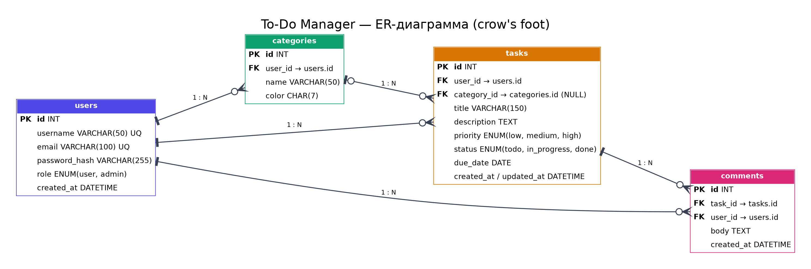
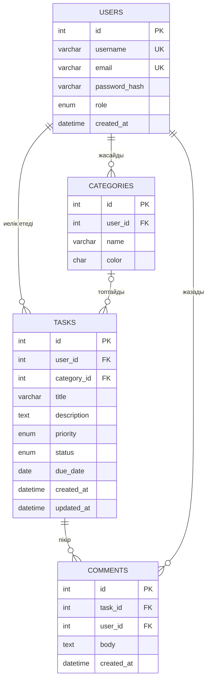

Жеке жобалық тапсырма: PHP қолданып веб-қосымша әзірлеу
8-апта. Жоспарлау және репозиторий құру
Орындаған: Қырықбай Зейнеп
Топ: Ақпараттық жүйелер 336

**Тақырыбы:** Тапсырмалар менеджері (To-Do)
1-кезең. Тақырыпты таңдау, жобаның мақсаты мен мүмкіндіктерін сипаттау

1.	Тақырып таңдау
Жеке жобалық тапсырма үшін ұсынылған тақырыптар тізімінен «Тапсырмалар менеджері (To-Do)» тақырыбы таңдадым. Жоба PHP және MySQL негізінде жасалатын веб-қосымша болады: пайдаланушы тіркеліп, өз тапсырмаларын қосады, санаттарға бөледі, мерзімі мен басымдығын белгілейді және орындалу барысын қадағалайды.
Тақырып келесі себептерге байланысты таңдалды:
–	тақырып түсінікті, оның нақты практикалық мәні бар: тапсырмаларды жоспарлау әр адамға қажет;
–	жоба курстың барлық міндетті талабын табиғи түрде қамтиды: тіркелу және кіру, іздеу және сүзу, валидация, қауіпсіздік;
–	қосымша функциялар (пікірлер, рөлдер) арқылы жобаны кеңейтуге мүмкіндік бар.

3. Шешілетін мәселе
Күнделікті міндеттер әдетте әр жерде шашырап жүреді: қағаз парақтарда, мессенджерлерде немесе жадта. Нәтижесінде тапсырмалардың мерзімі ұмытылады, маңыздысы мен маңызсызы ажыратылмайды, орындалған жұмыстың барысын көру қиындайды. Жоба осы мәселені бір жерде жинақталған, әр пайдаланушыға жеке тапсырмалар тізімін ұсынатын қарапайым әрі қауіпсіз веб-қосымша арқылы шешеді.

4. Жобаның мақсаты
PHP және MySQL қолданып, пайдаланушыға өз тапсырмаларын тіркеліп, жеке кабинетте басқаруға мүмкіндік беретін «Тапсырмалар менеджері» веб-қосымшасын әзірлеу және оны хостингке орналастыру.

6. Жобаның міндеттері
1.	Жобаның мақсаты, мүмкіндіктері мен беттер тізімін анықтау.
2.	Дерекқор құрылымын жобалап, ER-диаграмма сызу.
3.	GitHub-та репозиторий ашып, жобаның сипаттамасын README файлына жазу.
4.	HTML, CSS және JavaScript көмегімен адаптивті интерфейс жасау.
5.	Тіркелу, кіру және шығу жүйесін сессиялар арқылы іске асыру.
6.	Тапсырмалармен жұмыс істеудің толық CRUD операцияларын жасау.
7.	Іздеу, сүзу, сұрыптау және пагинация қосу.
8.	Қауіпсіздік шараларын қолдану: prepared statements, htmlspecialchars(), password_hash().
9.	Жобаны тестілеу және дайындау.

6. Жобаның негізгі мүмкіндіктері
Аутентификация - тіркелу, кіру және шығу; парольдер хэштелген түрде сақталады; жабық беттер сессия арқылы қорғалады.
Тапсырмалар (CRUD) - тапсырманы қосу, көру, өңдеу және жою. Әр тапсырмада тақырып, сипаттама, санат, басымдық және мерзім болады.
Мәртебелер - тапсырма үш күйде болады: орындалуы керек, орындалуда, орындалды.
Санаттар - пайдаланушы өз санаттарын жасап, тапсырмаларды топтастырады.
Іздеу және сүзу - тақырып бойынша іздеу; санат, мәртебе, басымдық пен мерзім бойынша сүзу; сұрыптау; пагинация.
Пікірлер - тапсырмаға пікір қалдыру (қосымша функция).
Рөлдер - пайдаланушы және әкімші рөлдері; әкімші пайдаланушылар тізімін басқарады.
- Тіркелу, кіру және шығу 
- Тапсырмаларды қосу, көру, өңдеу, жою 
- Тапсырмаға санат, басымдық (low / medium / high) және мерзім беру
- Мәртебе: `todo` → `in_progress` → `done`
- Іздеу, сүзу (санат, мәртебе, мерзім), сұрыптау және пагинация
- Тапсырмаға пікір қалдыру
- Рөлдер: `user` және `admin` (админ-панель)
- Қауіпсіздік: prepared statements, `htmlspecialchars()`, CSRF-токен

7. Дерекқор құрылымы (ER-диаграмма)

SQL-схема: database/schema.sql

**Байланыстар:**
- Бір пайдаланушыда көп санат және көп тапсырма болады (1 : N).
- Санат көп тапсырманы біріктіреді; санатсыз тапсырма да болады (`category_id` — NULL).
- Бір тапсырмада көп пікір болады, әр пікірдің бір авторы бар.

8. Қауіпсіздік шаралары

- Парольдер `password_hash()` арқылы сақталады, `password_verify()` арқылы тексеріледі.
- Барлық SQL-сұраныс PDO prepared statements арқылы орындалады.
- Пайдаланушыдан келген деректер экранға `htmlspecialchars()` арқылы шығарылады.
- Формаларда CSRF-токен қолданылады.
- Жабық беттер сессия мен рөл бойынша қорғалады; тапсырмаға қолжетімділік `user_id` арқылы тексеріледі.

## Лицензия
Оқу жобасы. Курстық жұмыс ретінде әзірленген.
